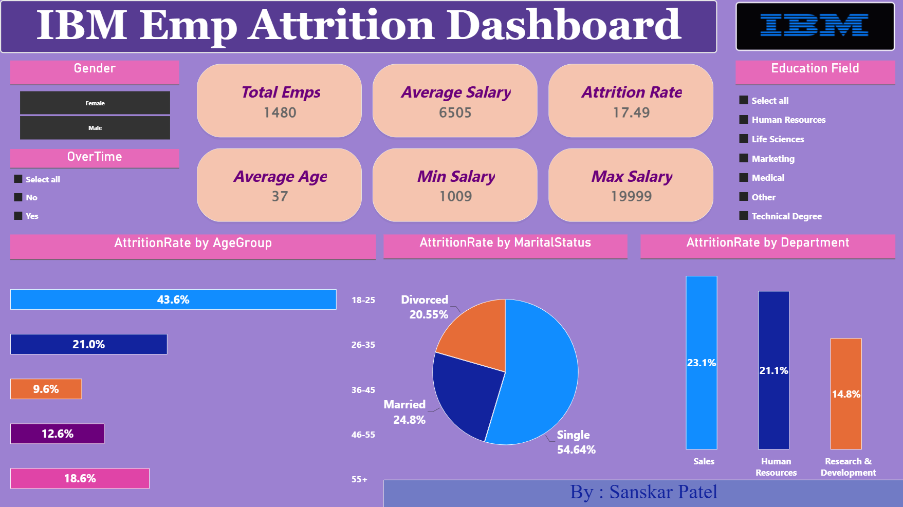

# 📊 IBM Employee Attrition Dashboard

An interactive Power BI dashboard designed to analyze employee attrition and explore workforce trends using data visualization and DAX-based metrics.

## 🖥️ Dashboard Preview

## 🎯 Project Overview

Employee attrition can affect workforce stability, productivity, and organizational performance. This project explores employee attrition patterns through an interactive dashboard built with Microsoft Power BI.

The dashboard presents key workforce metrics and visual breakdowns to help users explore attrition across different employee demographics and organizational categories.

## 📈 Key Performance Indicators

* **Total Employees:** 1,480
* **Average Salary:** 6,505
* **Attrition Rate:** 17.49%
* **Average Age:** 37 years
* **Minimum Salary:** 1,009
* **Maximum Salary:** 19,999

*These figures reflect the dashboard's displayed values.*

## 🔍 Dashboard Analysis

The dashboard includes visualizations covering:

* **Age Groups:** Explore attrition across employee age categories.
* **Marital Status:** Compare attrition patterns by marital status.
* **Department:** Examine attrition across organizational departments.
* **Gender:** Filter the dashboard by gender.
* **OverTime:** Explore attrition patterns using overtime status.
* **Education Field:** Filter employees by their education field.

## 🛠️ Tools & Technologies

* Microsoft Power BI
* DAX (Data Analysis Expressions)
* Data Visualization
* Interactive Slicers and KPI Cards

## 💡 Project Objectives

* Present employee attrition metrics in an interactive dashboard.
* Explore workforce patterns across demographic and organizational categories.
* Practice dashboard design, data analysis, and KPI reporting.
* Communicate workforce insights through clear visualizations.

## 🚀 View the Project

* **Dashboard Preview:** View the dashboard screenshot above.
* **GitHub Repository:** Explore the project documentation in this repository.
* **Power BI Report:** [Open the interactive report](https://app.powerbi.com/reportEmbed?reportId=e45cebf6-d40b-4469-87db-24e1ab5572ad&autoAuth=true&ctid=56c1d497-700b-49cf-8f8d-3dd6b20d522f).
*  Microsoft sign-in may be required.

**Power BI Report:** The interactive report is published to Power BI Service, but the current link requires Microsoft sign-in. Public access has not yet been enabled.

## 👨‍💻 Author

**Sanskar Patel**

* GitHub: [sanskarpatel-AI-ML](https://github.com/sanskarpatel-AI-ML)

---

*Created as a data analytics portfolio project.*

